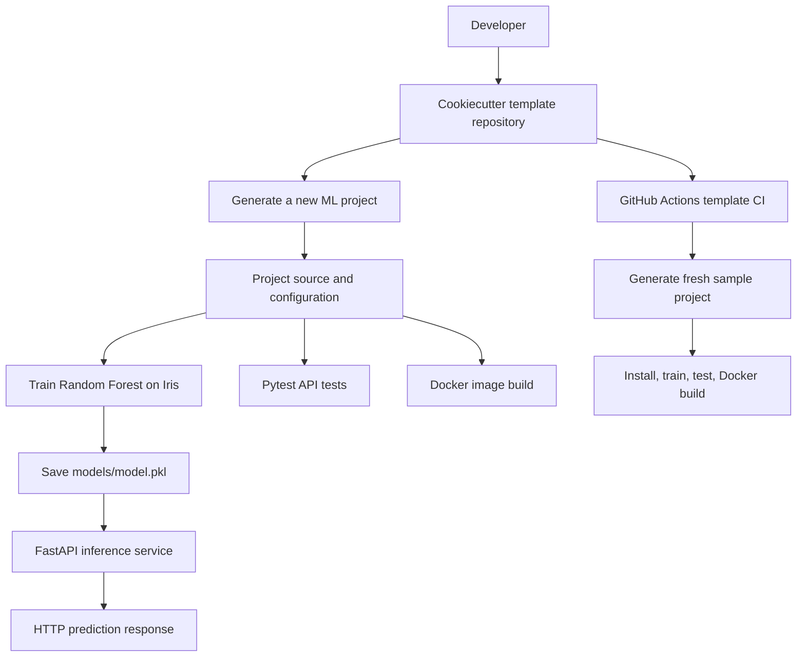

# Automated MLOps Project Template Builder

[](https://github.com/johnson-busuyi/MLOps-Template-Builder/actions/workflows/template-ci.yml)

A reusable **MLOps project scaffolding tool** built with [Cookiecutter](https://cookiecutter.readthedocs.io/). It generates a consistent machine learning project structure containing a sample model training pipeline, prediction script, FastAPI inference service, Docker configuration, automated tests, and GitHub Actions CI workflow.

**Repository:** https://github.com/johnson-busuyi/MLOps-Template-Builder

> **Project scope:** This repository is a **template generator**, not a customer-churn prediction model or a production model registry. The generated Iris classifier is a small demonstration used to verify that the scaffolding works end to end.

## 1. Objectives

- Automate the creation of standardized MLOps project folders and starter files.
- Reduce repetitive setup work and promote consistent code organization.
- Demonstrate a working train → save → predict → serve → test workflow.
- Package a generated application in Docker.
- Automatically validate the template on GitHub using CI.
- Provide reproducible instructions and documentation for future ML projects.

## 2. Technology stack

| Technology | Role | Version / evidence |
| --- | --- | --- |
| Python | Runs generated ML scripts and API | **3.13.9** locally |
| Cookiecutter | Generates project folders/files from a template | **2.7.1** locally |
| Git | Source control | **2.43.0.windows.1** locally |
| GitHub | Hosts the reusable template | `main` branch |
| scikit-learn | Iris dataset, Random Forest, train/test split and evaluation | See installed requirements |
| Joblib | Serializes and loads the trained model | See installed requirements |
| FastAPI + Pydantic | HTTP inference API and request validation | See installed requirements |
| Uvicorn | ASGI server for FastAPI | See installed requirements |
| Docker | Builds and runs a containerized inference application | Verify with `docker --version` |
| Pytest | Automated endpoint tests | **9.1.1** locally |
| GitHub Actions | Template validation CI | Successful run #1, commit `f689e2e` |
| Readme.so | Optional README authoring reference | https://readme.so/ |

**Dependency note:** The local test setup reported an `httpx2` dependency requirement from Starlette's test client. Before changing or pinning dependencies, check the actual environment with `python -m pip show httpx httpx2 starlette fastapi` and ensure the generated `requirements.txt` installs everything the test runner needs. Do not assume that `httpx` and `httpx2` are interchangeable.

## 3. Architecture



### Two levels of automation

**Template repository CI:** `.github/workflows/template-ci.yml` at the root of this repository generates a *new* project and validates that it works. This is the workflow that GitHub runs when changes are pushed to the template repository.

**Generated project CI:** `{{cookiecutter.project_slug}}/.github/workflows/ci.yml` is copied into each generated project. It runs when **that generated project** is committed to its own GitHub repository. A nested workflow is not automatically run by GitHub for the parent template repository.

## 4. Repository layout

```text
mlops-template/
├── .github/
│   └── workflows/
│       └── template-ci.yml       # Validates the template itself
├── cookiecutter.json             # Prompts/defaults for new projects
├── .gitignore
└── {{cookiecutter.project_slug}}/
    ├── .github/
    │   └── workflows/
    │       └── ci.yml            # CI included in generated projects
    ├── app/
    │   ├── __init__.py
    │   └── main.py               # FastAPI endpoints
    ├── data/
    │   ├── raw/.gitkeep
    │   └── processed/.gitkeep
    ├── models/.gitkeep
    ├── notebooks/.gitkeep
    ├── src/
    │   ├── __init__.py
    │   ├── train.py              # Model training and saving
    │   └── predict.py            # Local inference
    ├── tests/
    │   └── test_model.py         # Endpoint tests
    ├── .dockerignore
    ├── .gitignore
    ├── Dockerfile
    ├── README.md
    └── requirements.txt
```

Empty folders are retained in Git using `.gitkeep`. The generated project's `.gitignore` excludes local environments, datasets, and trained model artifacts.

## 5. Prerequisites

- Python 3.13 (the project was developed locally with Python 3.13.9)
- Git
- Docker Desktop / Docker Engine, for container builds
- A terminal (the walkthrough used **Git Bash on Windows**)
- A GitHub account, if publishing or running hosted CI

Check your tools:

```bash
python --version
git --version
docker --version
docker info
```

`docker info` checks whether the Docker engine is accessible, not just whether the CLI is installed.

## 6. Clone and generate a project

Clone the **template repository**:

```bash
git clone https://github.com/johnson-busuyi/MLOps-Template-Builder.git
cd MLOps-Template-Builder
```

Create and activate a virtual environment (Git Bash on Windows):

```bash
python -m venv .venv
source .venv/Scripts/activate
python -m pip install cookiecutter
cookiecutter --version
```

Generate a project interactively:

```bash
cookiecutter .
```

Cookiecutter reads `cookiecutter.json` and asks for values such as:

```json
{
  "project_name": "Customer Churn MLOps",
  "project_slug": "{{ cookiecutter.project_name.lower().replace(' ', '-') }}",
  "author_name": "Your Name",
  "description": "A reusable machine learning project structure",
  "python_version": "3.13"
}
```

For example, enter `Iris ML Demo` as the project name and use `iris-ml-demo` as the slug. Or generate it without prompts:

```bash
cookiecutter . --no-input project_name="Iris ML Demo" project_slug="iris-ml-demo"
cd iris-ml-demo
```

**Note:** The local demonstration project was named `Bustop`; that name is not required by the template. The generated folder is determined by the selected `project_slug`.

## 7. Install generated project dependencies

From the **generated project directory**:

```bash
python -m pip install -r requirements.txt
```

The template uses pandas, NumPy, scikit-learn, FastAPI, Uvicorn, Pytest, and Joblib. HTTP test-client dependencies must also be installed as specified by the project's verified requirements.

For reproducibility in future production projects, pin or lock tested dependency versions rather than relying indefinitely on unconstrained latest releases.

## 8. Train and evaluate the demonstration model

```bash
python -m src.train
```

The training script:

1. Loads scikit-learn's built-in **Iris dataset** (150 observations).
2. Splits the data into **80% training / 20% testing**, with `random_state=42`.
3. Fits `RandomForestClassifier(n_estimators=100, random_state=42)`.
4. Computes classification accuracy on the held-out split.
5. Saves the model with Joblib to `models/model.pkl`.

**Observed local output from the `Bustop` sample:**

```text
Model Accuracy: 1.00
Model saved to: C:\Users\user\MLOP-Project\MLOps-Template-Builder\Bustop\models\model.pkl
```

The saved artifact was approximately **183 KB**. The 1.00 accuracy is the observed result on this small test split, **not** a guarantee of perfect performance on new data.

Make a local prediction:

```bash
python -m src.predict
```

Observed output:

```text
Prediction: 0
```

The example measurements `[5.1, 3.5, 1.4, 0.2]` produce class `0`, corresponding to **setosa**. The other Iris labels are `1 = versicolor` and `2 = virginica`.

## 9. Serve predictions with FastAPI

From the generated project's root, after training the model:

```bash
python -m uvicorn app.main:app --reload --port 8001
```

Open the interactive API documentation:

- Swagger UI: http://127.0.0.1:8001/docs
- OpenAPI JSON: http://127.0.0.1:8001/openapi.json

| Method | Route | Function |
| --- | --- | --- |
| GET | `/` | Returns a welcome message |
| GET | `/health` | Returns health status or HTTP 503 if the model is not loaded |
| POST | `/predict` | Accepts four Iris measurements and returns a class/species |

Example request:

```bash
curl -X POST http://127.0.0.1:8001/predict \
  -H 'Content-Type: application/json' \
  -d '{"sepal_length":5.1,"sepal_width":3.5,"petal_length":1.4,"petal_width":0.2}'
```

Expected response:

```json
{
  "prediction": 0,
  "species": "setosa"
}
```

The FastAPI lifespan handler loads `models/model.pkl` once at application startup. Pydantic validates that all four measurements are positive numeric values. The `--reload` flag is for **local development only**.

## 10. Docker: build and run

The generated `Dockerfile` uses `python:3.13-slim`, installs dependencies, copies the project, trains the small sample model **during image build**, and starts Uvicorn on container port **8001**.

Build the image from the generated project root:

```bash
docker build -t mlops-template-api:v1 .
```

Inspect images:

```bash
docker images
```

Run the container:

```bash
docker run -d --name mlops-api -p 8002:8001 mlops-template-api:v1
```

Docker uses `-p HOST_PORT:CONTAINER_PORT`: **8002** is the port on your computer; **8001** is the port Uvicorn listens on inside the container. Port 8002 was chosen to avoid conflicts with previously used local ports 8000 (MLflow) and 8001 (local FastAPI).

Verify:

```bash
docker ps
docker logs mlops-api
curl http://127.0.0.1:8002/health
```

Swagger UI in Docker: http://127.0.0.1:8002/docs

Stop and remove the container:

```bash
docker stop mlops-api
docker rm mlops-api
```

**Production distinction:** Training during the Docker build is convenient for this Iris demo. A production pipeline should normally train, evaluate, approve, and version models separately, then package a specific model artifact for serving.

## 11. Automated tests with Pytest

The generated `tests/test_model.py` checks:

- `GET /` returns HTTP 200.
- `GET /health` returns HTTP 200 and `{"status": "healthy"}`.
- `POST /predict` returns HTTP 200 and the expected Iris prediction.

Train the model before running tests, then execute from the **generated project root**:

```bash
python -m src.train
python -m pytest tests/ -v
```

**Observed local result:**

```text
tests/test_model.py::test_home PASSED
tests/test_model.py::test_health PASSED
tests/test_model.py::test_prediction PASSED

3 passed in 15.85s
```

The observed test environment used Python **3.13.9**, Pytest **9.1.1**, Pluggy **1.6.0**, and AnyIO **4.15.1**.

These are API behavior tests; they are not an exhaustive evaluation of model quality, data drift, security, or production readiness.

## 12. GitHub Actions CI

### A. Template repository workflow

File: `.github/workflows/template-ci.yml`

Triggers:

```yaml
on:
  push:
  pull_request:
  workflow_dispatch:
```

The root workflow checks out the repository, sets up Python 3.13, installs Cookiecutter, generates a fresh `iris-ml-demo` project, installs dependencies, trains the model, runs tests, and builds a Docker image.

**Verified result:** GitHub Actions **Cookiecutter Template CI** run **#1** passed on the `main` branch, commit **`f689e2e`**, with a reported duration of **59 seconds**.

[View GitHub Actions runs](https://github.com/johnson-busuyi/MLOps-Template-Builder/actions)

### B. Generated project workflow

File inside the template: `{{cookiecutter.project_slug}}/.github/workflows/ci.yml`

Once a generated project is pushed to its **own** GitHub repository, this workflow can install dependencies, train the model, and execute Pytest. It is a separate workflow from the root template validation pipeline.

### CI versus deployment

This project implements **continuous integration and Docker image build validation**. It does **not** automatically publish the image to a container registry or deploy it to a cloud environment. Those would be separate CD steps.

## 13. Git workflow and publishing

The reusable template was committed and pushed to GitHub on the `main` branch:

```bash
git init
git add .
git commit -m "Initial commit: Automated MLOps Cookiecutter template"
git branch -M main
git remote add origin https://github.com/johnson-busuyi/MLOps-Template-Builder.git
git push -u origin main
```

The initial verified commit was `de1bee5`. A later commit, `f689e2e`, added the root template-validation CI workflow.

For subsequent changes:

```bash
git status
git add .
git commit -m "Describe your change"
git push origin main
```

Do not re-run `git remote add origin` if the remote already exists.

## 14. Troubleshooting and fixes

| Symptom | Cause | Resolution |
| --- | --- | --- |
| `cd: iris-ml-demo: No such file or directory` | Project was generated with a different slug (`Bustop`) | Run `ls -la`, use the actual folder name, or generate a new project with the desired slug |
| `cat app/main.py` prints nothing | Generated starter file was empty | Add code to the **original template**, then regenerate or copy the updated file into the existing project |
| Browser on port 8000 shows MLflow | Another service was using port 8000 | Run FastAPI with `--port 8001`; expose the Dockerized API on host port 8002 |
| `ERROR: file or directory not found: tests/` | Pytest was run from inside `tests/` while targeting `tests/` | `cd ..` to the generated project root and run `python -m pytest tests/ -v` |
| Test collection fails due to missing HTTP client dependency | Starlette TestClient's required package was missing | Install the dependency requested by the actual environment, record it in the template's `requirements.txt`, and re-run tests |
| `GET /health` returns 503 | Model file not available when FastAPI started | Run `python -m src.train`, then restart Uvicorn |
| Docker port bind error | Requested host port already in use | Choose a free host port, e.g. `-p 9000:8001` |
| Nested GitHub workflow does not run for template pushes | GitHub only discovers workflows at the repository root | Use `.github/workflows/template-ci.yml` in the template repository |
| Docker container exits | Application startup or dependency error | Inspect `docker logs mlops-api` and verify model and dependencies |

## 15. What this project demonstrates

- **Automation:** One template generates a standardized ML project repeatedly.
- **Reusability:** New projects can change their names and metadata without rebuilding the folder structure.
- **ML lifecycle basics:** Train, evaluate, serialize, load, and predict.
- **API development:** Expose predictions through a documented HTTP interface.
- **Containerization:** Build a portable application image and map container ports.
- **Testing:** Validate API endpoints automatically.
- **CI:** Test the generator itself by producing a fresh project on every push or pull request.
- **Version control:** Track changes and publish the reusable template through GitHub.

## 16. Lessons learned

1. **Templates and generated projects are different artifacts.** Fix reusable starter code in the template first; an already generated project does not automatically update when the template changes.
2. **Directory context matters.** Commands such as `python -m pytest tests/ -v` assume execution from the generated project root.
3. **Dependencies must be recorded.** Passing tests in a local environment is not sufficient if a clean CI environment cannot install the same requirements.
4. **Host and container ports are separate.** Docker's `-p 8002:8001` maps a host port to the service inside the container.
5. **A CI workflow must be in the right repository location.** A nested workflow is copied to generated projects, while the template's own workflow must be at its root.
6. **A small demo can validate the complete structure.** The Iris dataset makes it possible to test training and inference without downloading a large dataset.
7. **Green CI is meaningful evidence.** The successful GitHub Actions run demonstrated that the template could generate, train, test, and build on a clean runner.

## 17. Potential future improvements

- Add configurable ML task types and model algorithms instead of always using Iris/Random Forest.
- Separate model training from the Docker image build and introduce model versioning.
- Add dependency lockfiles, linting, type checking, and security scanning.
- Add dataset and model validation tests, beyond basic API smoke tests.
- Add MLflow tracking as an optional feature (not part of the current template).
- Publish Docker images to a registry and add a deployment pipeline.
- Improve API startup error handling and implement production readiness checks.

## 18. Interview-ready project summary

> I developed a reusable MLOps project scaffolding tool using Cookiecutter to standardize the setup of machine learning repositories. The generated projects include a Random Forest demonstration pipeline, FastAPI inference endpoints, Docker packaging, and automated Pytest checks. I also configured GitHub Actions to generate a fresh project, train its model, run tests, and verify a Docker build automatically. The template-validation workflow passed successfully on GitHub, demonstrating that the scaffolding works in a clean CI environment.

## References

- [Cookiecutter documentation](https://cookiecutter.readthedocs.io/)
- [FastAPI documentation](https://fastapi.tiangolo.com/)
- [FastAPI lifespan events](https://fastapi.tiangolo.com/advanced/events/)
- [scikit-learn documentation](https://scikit-learn.org/stable/)
- [Docker documentation](https://docs.docker.com/)
- [Pytest documentation](https://docs.pytest.org/)
- [GitHub Actions documentation](https://docs.github.com/en/actions)
- [Readme.so](https://readme.so/)

---

**Project:** Automated MLOps Project Template Builder  
**Repository:** [johnson-busuyi/MLOps-Template-Builder](https://github.com/johnson-busuyi/MLOps-Template-Builder)
